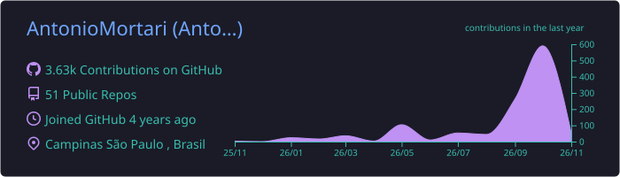
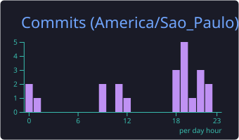
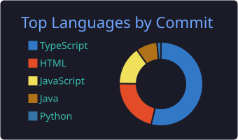

 

## 👨‍💻 Sobre mim

- 💼 Desenvolvedor **Back-end** na **MB Labs**
- 🎓 Estudante de **Análise e Desenvolvimento de Sistemas (ADS)** na **Fatec Campinas**

 

## 🛠️ Tecnologias

 

## 📊 Estatísticas

 

  

 

## 📫 Contato

 

  

